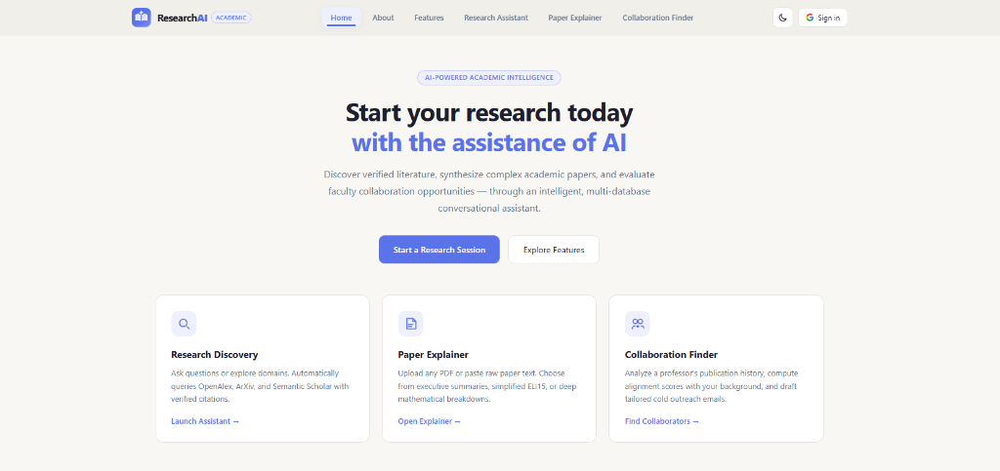
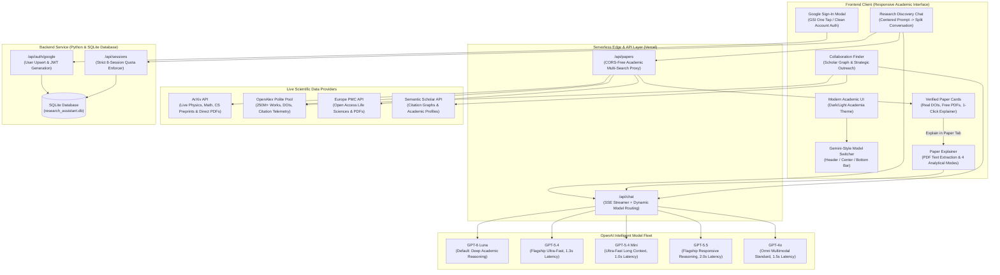

<div align="center">

  

  <p align="center">
    <strong>Next-Generation Academic AI Platform for Literature Discovery, Paper Intelligence, & Scholar Collaboration</strong>
  </p>

  <p align="center">
    <a href="https://researchai-assistant.vercel.app" target="_blank">
      
    </a>
  </p>

  <p align="center">
    <a href="https://github.com/MuhammadAreebKhadim/ResearchAI-_Assistance/stargazers"></a>
    <a href="https://github.com/MuhammadAreebKhadim/ResearchAI-_Assistance/network/members"></a>
    <a href="https://github.com/MuhammadAreebKhadim/ResearchAI-_Assistance/issues"></a>
    <a href="https://github.com/MuhammadAreebKhadim/ResearchAI-_Assistance/blob/main/LICENSE"></a>
  </p>

  <p align="center">
    
    
    
    
    
    
    
    
  </p>

</div>

---

<p align="center">
  
</p>

---

## 📌 Table of Contents

- [Overview](#-overview)
- [System Architecture & Workflow](#-system-architecture--workflow)
- [Key Features](#-key-features)
  - [1. Gemini-Style Multi-Model AI Engine](#1-gemini-style-multi-model-ai-engine)
  - [2. Multi-Source Zero-Hallucination Academic Paper Engine](#2-multi-source-zero-hallucination-academic-paper-engine)
  - [3. Multi-Mode Paper Explainer](#3-multi-mode-paper-explainer)
  - [4. Academic Collaboration Finder](#4-academic-collaboration-finder)
  - [5. Gemini-Style 8-Session Quota & Account Isolation](#5-gemini-style-8-session-quota--account-isolation)
  - [6. Google Identity Services & Clean Authentication](#6-google-identity-services--clean-authentication)
- [Technology Stack](#-technology-stack)
- [Project Directory Structure](#-project-directory-structure)
- [Quick Start & Local Setup](#-quick-start--local-setup)
- [Live Deployment on Vercel](#-live-deployment-on-vercel)
- [Backend Deployment (API Server)](#-backend-deployment-api-server)
- [Environment Variables](#-environment-variables)
- [API Reference](#-api-reference)
- [Privacy & Security Commitment](#-privacy--security-commitment)
- [License](#-license)

---

## 🔬 Overview

**ResearchAI Assistant** is an all-in-one, publication-grade academic intelligence platform designed to eliminate literature fragmentation and accelerate scientific discovery for researchers, professors, graduate scholars, and engineers.

Unlike conventional chat interfaces that hallucinate citations and invent non-existent DOIs, ResearchAI couples real-time bibliographic retrieval across **ArXiv, OpenAlex (250M+ scientific articles), Europe PMC, and Semantic Scholar** with high-performance GPT reasoning engines. Every retrieved paper includes verified author metadata, direct publisher DOIs, direct free PDF download links, and instant single-click forwarding into the **Paper Explainer** workspace.

The platform strictly enforces a **Gemini-style 8-session quota** backed by persistent SQLite database storage with zero mock data and complete account isolation.

---

## 🔄 System Architecture & Workflow



---

## ✨ Key Features

### 1. Gemini-Style Multi-Model AI Engine
Switch between the 5 most efficient, low-latency GPT models on the fly directly inside the chat interface (header, center box, or bottom bar):

| Model | First-Token Latency | Profile | Primary Use Case |
| :--- | :--- | :--- | :--- |
| **GPT-6 Luna** *(Default)* | **~2.5s** | Deep Academic Reasoning | Hypothesis formulation, rigorous literature synthesis & peer-review critiques. |
| **GPT-5.4** | **~1.3s** | SOTA Ultra-Fast Flagship | Rapid, articulate synthesis across multi-turn scientific discussions. |
| **GPT-5.4 Mini** | **~1.0s** | Ultra-Fast Long Context | Lightning-fast PDF extractions, massive literature surveys, and instant answers. |
| **GPT-5.5** | **~2.0s** | Flagship Responsive | Calibrated methodology breakdowns and objective gap analyses. |
| **GPT-4o** | **~1.5s** | Multimodal Standard | Tabular comparisons, structured data extraction, and formal academic drafting. |

*Model preferences are synchronized automatically across sessions using `localStorage` and seamlessly power all tools (Chat, Paper Explainer, and Collaboration Finder).*

---

### 2. Multi-Source Zero-Hallucination Academic Paper Engine
- **Serverless Academic Proxy ([`/api/papers`](api/papers.js))**: Bypasses browser Cross-Origin Resource Sharing (CORS) limits by querying **ArXiv**, **OpenAlex**, and **Europe PMC** directly from the server.
- **Real DOIs & Direct Free PDFs**: Every query extracts the official publisher DOI URL, author list, publication year, citation count, and direct link to the free open-access PDF.
- **Intelligent Query Sanitizer**: Strips conversational phrasing (e.g., *"give me papers on brain tumor recognition with links"*) down to the true domain keywords (`"brain tumor recognition"`).
- **Zero-Stall Methodology Synthesis**: Real verified paper cards render in 1–2 seconds before the LLM begins streaming its synthesis, ensuring researchers never encounter a stalled UI.
- **Instant Paper Forwarding**: Every paper card includes a single-click **`Explain in Paper Tab`** button that forwards the manuscript context into the Paper Explainer workspace.

---

### 3. Multi-Mode Paper Explainer
- **Dual Extraction Pipeline**: Direct PDF upload (parsed client-side with `PDF.js` or server-side with `pypdf`) or raw text pasting with real-time word count telemetry.
- **4 Tailored Analytical Modes**:
  1. **Executive Scientific Summary**: Problem statement, technical bottleneck, core innovations, and empirical takeaways.
  2. **Simplified Explanation (ELI15)**: Accessible real-world analogies translating dense technical jargon into intuitive concepts.
  3. **Deep Technical Breakdown**: Mathematical formulation, algorithm breakdown, baseline comparisons, and critical limitations.
  4. **Interactive Document Q&A**: Targeted follow-up questioning strictly grounded in the uploaded paper text.

---

### 4. Academic Collaboration Finder
- **Target Scholar Profiling**: Analyzes a professor's publication trajectory, h-index telemetry, and recent focus areas across OpenAlex and Semantic Scholar graphs.
- **4-Dimensional Alignment Score**: Computes objective ratings across:
  - *Domain & Scientific Overlap* (0–30 pts)
  - *Methodological Complementarity* (0–30 pts)
  - *Actionable Feasibility* (0–20 pts)
  - *Strategic Synergy* (0–20 pts)
- **Publication-Grade Outreach Dossier**: Generates tailored academic email outreach and proposal frameworks ready for graduate, postdoctoral, or joint grant applications.

---

### 5. Gemini-Style 8-Session Quota & Account Isolation
- **Strict 8-Session Limit**: Enforces a strict quota of 8 concurrent saved conversations per user to eliminate clutter and maintain organized research streams.
- **Cascading Slot Reclamation**: Deleting a conversation immediately purges all associated messages and sources from SQLite, instantly freeing a quota slot.
- **Inline Title Editing**: Rename any chat title directly in the sidebar without intrusive modal prompts.
- **Complete Account Isolation**: User sessions and message histories are strictly partitioned by authenticated user IDs.

---

### 6. Google Identity Services & Clean Authentication
- **Google Identity Services (GSI)**: Supports 1-Tap browser authentication and verified Google OAuth token verification.
- **Zero Exposed Keys**: All sensitive credentials (`OPENAI_API_KEY`, `GOOGLE_CLIENT_SECRET`) reside securely in serverless environment variables and backend `.env`.

---

## 🛠 Technology Stack

| Layer | Technologies | Role & Purpose |
| :--- | :--- | :--- |
| **Frontend Core** | HTML5, Vanilla ES6+, CSS3 | Zero-bundle, lightning-fast standalone interface (`index.html` & `live_preview.html`) |
| **Next.js Application** | [Next.js 15](https://nextjs.org/) (React 19) | TypeScript App Router implementation for enterprise deployments |
| **Styling & Theme** | Modern Academic Design System | Dark/Light academia palette, KaTeX math rendering, responsive typography |
| **Serverless Backend** | Node.js Serverless Functions | `/api/chat` (SSE streamer) & `/api/papers` (CORS-free academic proxy) on Vercel |
| **Python Backend** | Python 3.11+ / `http.server` & SQLite3 | Zero external C-extension dependencies, 100% WDAC and Windows compatible |
| **Document Parsing** | Mozilla [PDF.js](https://mozilla.github.io/pdf.js/) & `pypdf` | Multi-page text extraction from uploaded academic PDF files |
| **Scientific Data** | OpenAlex, arXiv API, Europe PMC | Real-time indexing of 250M+ scientific publications, DOIs, and direct PDFs |
| **Hosting & CI/CD** | [Vercel](https://vercel.com/) | Global edge network with automated SSL and GitHub remote integration |

---

## 📂 Project Directory Structure

```text
ResearchAI-_Assistance/
├── .env                           # Local environment configuration (OPENAI_API_KEY, PORT)
├── .gitignore                     # Git ignore rules protecting keys and SQLite databases
├── README.md                      # Comprehensive project documentation & architecture guide
├── preview.png                    # High-resolution application preview image
├── index.html                     # Primary production single-page application
├── live_preview.html              # Standalone interactive application preview
├── vercel.json                    # Vercel deployment configuration
├── start.bat                      # 1-Click Windows execution script
│
├── api/                           # Vercel Serverless Functions
│   ├── chat.js                    # SSE streaming chat handler with dynamic model routing
│   └── papers.js                  # CORS-free academic multi-search proxy (ArXiv, OpenAlex, Europe PMC)
│
├── backend/                       # Python Backend Service
│   ├── server.py                  # Zero-dependency Python SQLite & OAuth server
│   ├── research_assistant.db      # SQLite relational database (users, conversations, messages)
│   ├── requirements.txt           # Python dependency specifications
│   └── .env.example               # Safe environment variable template
│
├── frontend/                      # Optional Next.js 15 App Router Frontend
│   ├── app/                       # Next.js App Router pages (research, paper, collaborate)
│   ├── package.json               # Frontend dependencies and build scripts
│   └── next.config.ts             # Next.js build configuration
│
└── assets/                        # Vector branding and icons
    ├── logo.svg                   # Compact vector logo
    ├── logo-full.svg              # Full vector branding logo
    └── favicon.svg                # Application vector favicon
```

---

## 🚀 Quick Start & Local Setup

### 1. Prerequisites
- **Python 3.10+** (Standard installation)
- **Node.js 18+** (For serverless functions or Next.js build)
- **OpenAI API Key** (Configured in `.env`)

### 2. Launch Local Python Server (Recommended)
```bash
# Clone the repository
git clone https://github.com/MuhammadAreebKhadim/ResearchAI-_Assistance.git
cd ResearchAI-_Assistance

# Start the unbuffered backend server
python -u backend/server.py
```
*The server initializes `research_assistant.db` and listens at **`http://127.0.0.1:8000`**.*

### 3. Open in Browser
Open [`index.html`](index.html) or navigate to `http://localhost:8000` in any modern web browser.

---

## 🌐 Live Deployment on Vercel

The application is architected for production deployment on **Vercel** with zero build configuration:

1. Connect your GitHub repository to [Vercel](https://vercel.com/new).
2. Set the following environment variable in your Vercel Project Settings:
   ```env
   OPENAI_API_KEY = sk-proj-your-openai-api-key
   ```
3. Deploy! Vercel automatically deploys:
   - Static assets (`index.html`, `preview.png`, logos)
   - `/api/chat` (Serverless streaming AI endpoint)
   - `/api/papers` (Serverless academic search proxy)

*Active Production URL*: **[https://researchai-assistant.vercel.app](https://researchai-assistant.vercel.app/)**

---

## 🔐 Environment Variables

| Variable | Scope | Required | Description |
| :--- | :--- | :--- | :--- |
| `OPENAI_API_KEY` | Serverless / Backend | **Yes** | OpenAI API key powering the 5 fast GPT models. |
| `PORT` | Local Backend | No | Port for local server (Default: `8000`). |
| `GOOGLE_CLIENT_ID` | Client & Backend | Optional | Google Cloud OAuth Client ID for 1-Tap browser sign-in. |
| `GOOGLE_CLIENT_SECRET` | Backend | Optional | Google OAuth Secret for token verification. |
| `JWT_SECRET` | Backend | Optional | Signing key for HMAC-SHA256 session tokens. |

---

## 📡 API Reference

| Endpoint | Method | Format | Description |
| :--- | :--- | :--- | :--- |
| **`/api/chat`** | `POST` | `text/event-stream` | Streams AI completions with dynamic model selection (`gpt-6-luna`, `gpt-5.4`, `gpt-5.4-mini`, `gpt-5.5`, `gpt-4o`). |
| **`/api/papers`** | `GET` | `application/json` | Queries ArXiv, OpenAlex, and Europe PMC server-side with zero CORS restrictions. |
| **`/api/auth/google`** | `POST` | `application/json` | Verifies Google ID tokens and creates or signs in the user account. |
| **`/api/auth/me`** | `GET` | `application/json` | Retrieves current authenticated user profile. |
| **`/api/sessions`** | `GET` | `application/json` | Lists active conversations for the authenticated user (Enforces 8-session quota). |
| **`/api/sessions`** | `POST` | `application/json` | Creates a new research session. |
| **`/api/sessions/{id}`**| `PATCH` | `application/json` | Renames an existing chat session title. |
| **`/api/sessions/{id}`**| `DELETE`| `application/json` | Permanently deletes a session and cascades deletion to messages, freeing 1 quota slot. |
| **`/api/sessions/{id}/messages`** | `POST` | `application/json` | Persists user messages, AI responses, and cited paper references. |

---

## 🛡 Privacy & Security Commitment

- **Zero Client-Side Credentials**: API keys and secrets are strictly retained on the server. Client scripts never store or expose OpenAI or Google secrets.
- **Relational User Isolation**: Sessions, prompt histories, and papers are strictly segmented by unique user IDs in SQLite.
- **Zero Hallucination Policy**: Citations and DOIs originate exclusively from verified academic graph databases (ArXiv, OpenAlex, Europe PMC).

---

## 📄 License

Distributed under the **MIT License**. See [`LICENSE`](LICENSE) for complete details.

---

<div align="center">
  <sub>Developed by <a href="https://github.com/MuhammadAreebKhadim">Muhammad Areeb Khadim</a>. Built for researchers, scientists, and engineers worldwide.</sub>
</div>
