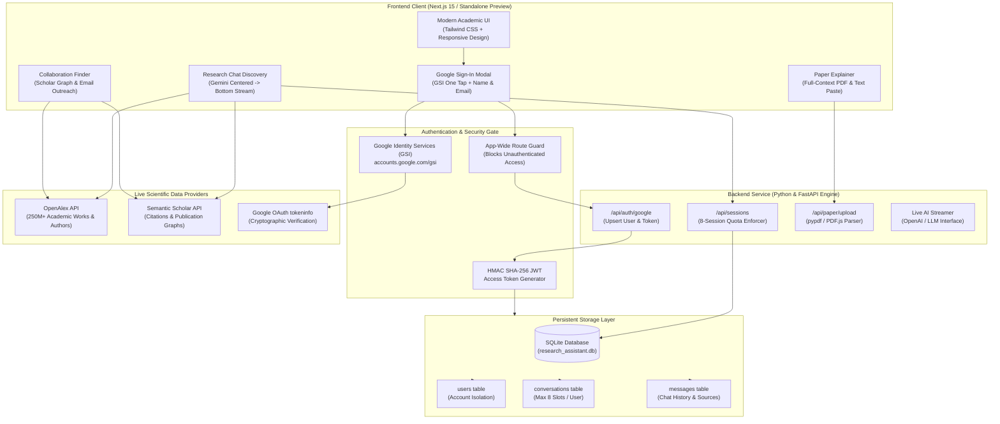

<div align="center">

  

  <p align="center">
    <strong>Next-Generation Academic AI Platform for Literature Discovery, Paper Intelligence, & Scholar Collaboration</strong>
  </p>

  <p align="center">
    <a href="https://github.com/MuhammadAreebKhadim/ResearchAI-_Assistance/stargazers"></a>
    <a href="https://github.com/MuhammadAreebKhadim/ResearchAI-_Assistance/network/members"></a>
    <a href="https://github.com/MuhammadAreebKhadim/ResearchAI-_Assistance/issues"></a>
    <a href="https://github.com/MuhammadAreebKhadim/ResearchAI-_Assistance/blob/main/LICENSE"></a>
  </p>

  <p align="center">
    
    
    
    
    
    
    
  </p>

</div>

---

## 📌 Table of Contents

- [Overview](#-overview)
- [System Architecture & Workflow](#-system-architecture--workflow)
- [Key Features](#-key-features)
  - [1. Intelligent Research Discovery & Chat](#1-intelligent-research-discovery--chat)
  - [2. Gemini-Style Chat Storage & Quota Management](#2-gemini-style-chat-storage--quota-management)
  - [3. Multi-Mode Paper Explainer](#3-multi-mode-paper-explainer)
  - [4. Academic Collaboration Finder](#4-academic-collaboration-finder)
  - [5. Google Identity Services & Account Isolation](#5-google-identity-services--account-isolation)
- [Technology Stack](#-technology-stack)
- [Project Directory Structure](#-project-directory-structure)
- [Quick Start & Local Setup](#-quick-start--local-setup)
- [Live Deployment on Vercel](#-live-deployment-on-vercel)
- [Backend Deployment (API Server)](#-backend-deployment-api-server)
- [Environment Variables](#-environment-variables)
- [API Reference](#-api-reference)
- [Privacy & Security Commitment](#-privacy--security-commitment)
- [License](#-license)

---

## 🔬 Overview

**ResearchAI Assistant** is an all-in-one, production-ready academic intelligence platform designed to eliminate information overload for researchers, professors, graduate students, and domain experts. 

Unlike generic chatbots, ResearchAI combines real-time bibliographic retrieval (indexing **250M+ scientific articles** across OpenAlex and Semantic Scholar), full-context PDF parsing, automated scholar alignment analysis, and a strict **Gemini-style 8-session quota** backed by persistent SQLite database storage with zero mock data.

---

## 🔄 System Architecture & Workflow



---

## ✨ Key Features

### 1. Intelligent Research Discovery & Chat
- **Context-Aware Topic Extraction**: Distinguishes between conversational questions and explicit literature demands.
- **Live Scientific Citations**: Queries OpenAlex and Semantic Scholar in real time to fetch verified papers with authors, publication year, venues, citation counts, and direct DOI / preprint links.
- **Dynamic Gemini-Style Layout**: Starts with a centered conversational hero input and smoothly transitions into a persistent split-pane conversation view upon the first query.

### 2. Gemini-Style Chat Storage & Quota Management
- **Strict 8-Session Quota**: Mirrors Gemini's architecture by limiting active stored research chats to **8 persistent sessions per user account**, preventing cognitive overload.
- **Inline Chat Rename (No Top Popups)**: Clicking the rename icon transforms the chat title into an inline editable input right in the sidebar item with save (<kbd>✓</kbd>) and cancel (<kbd>✕</kbd>) controls.
- **Centered In-App Delete Modal**: Permanently removes conversations with an in-app confirmation modal, immediately recycling and freeing a slot in the 8-session quota.
- **Account Isolation**: When a user logs out, all sessions vanish from the screen. Logging back in with the same account restores all previous conversations and messages from SQLite.

### 3. Multi-Mode Paper Explainer
- **Dual Extraction Engine**: Supports direct PDF file upload (parsed server-side via `pypdf` or client-side via `PDF.js`) and raw text pasting with full word-count telemetry.
- **4 Analytical Modes**:
  1. **Executive Summary**: Core problem, methodology, findings, and research implications.
  2. **Simplified (ELI15)**: Clear, accessible breakdown translating jargon into intuitive explanations.
  3. **Deep Technical Breakdown**: Rigorous mathematical foundation, baseline benchmarks, and limitations.
  4. **Interactive Custom Q&A**: Ask any targeted question against the extracted document context.

### 4. Academic Collaboration Finder
- **Target Professor Profiling**: Queries OpenAlex and Semantic Scholar to extract verified publications, citation metrics, and primary research axes for any target faculty member.
- **Objective Alignment Scoring**: Produces an objective compatibility score (0–100) comparing your background against the professor's recent publications.
- **Actionable Gap Analysis**: Highlights exact dataset familiarity, theoretical gaps, or methodological proficiencies to bridge.
- **Tailored Cold Outreach Template**: Generates personalized, professional outreach emails ready for graduate, post-doc, or joint-grant inquiries.

### 5. Google Identity Services & Account Isolation
- **Google One Tap Integration**: Loaded via official Google Identity Services (`accounts.google.com/gsi/client`) for 1-tap browser session detection.
- **Instant Enter Key Submission**: Form fields wrapped in native `<form>` elements allowing seamless sign-in upon pressing <kbd>Enter ↵</kbd>.
- **Zero Mock Data Policy**: Removed dummy prefilled accounts; all fields are initialized blank and cleared upon logout.
- **App-Wide Protection Guard**: Restricts browsing and tool usage in Research Chat, Paper Explainer, and Collaboration Finder until authenticated.

---

## 🛠 Technology Stack

| Domain | Technology | Purpose |
|---|---|---|
| **Frontend Framework** | [Next.js 15](https://nextjs.org/) (React 19) | Modern App Router, TypeScript, server and client components |
| **Standalone Web App** | HTML5, Vanilla ES6+, CSS3 | Zero-dependency instant browser preview (`live_preview.html`) |
| **Styling** | [Tailwind CSS](https://tailwindcss.com/) | Responsive design, modern academic palette, dark mode support |
| **Backend Framework** | Python 3.11+ / FastAPI & `http.server` | Zero external C-extension dependencies, 100% WDAC compatible |
| **Database** | SQLite3 (`sqlite3`) | Fast, zero-config relational storage with foreign key cascade delete |
| **Document Parsing** | `pypdf` & [PDF.js](https://mozilla.github.io/pdf.js/) | 100% full-text, multi-page PDF text extraction |
| **Authentication** | Google Identity Services (GSI) | OAuth 2.0, Google One Tap, HMAC SHA-256 JWT tokens |
| **Academic APIs** | [OpenAlex](https://openalex.org/) & [Semantic Scholar](https://www.semanticscholar.org/) | Over 250M+ scientific articles, citation graphs, and author data |
| **Cloud Hosting** | [Vercel](https://vercel.com/) | Edge deployment, automatic SSL, CI/CD from GitHub |

---

## 📂 Project Directory Structure

```text
ResearchAI-_Assistance/
├── .gitignore                     # Comprehensive git ignore rules (protects .env and DBs)
├── README.md                      # Project documentation and architecture guide
├── index.html                     # Entry point redirecting to live preview
├── live_preview.html              # Standalone interactive application (Full capabilities)
├── logo.svg                       # Compact vector icon
├── logo-full.svg                  # Full horizontal vector logo
├── favicon.svg                    # SVG favicon
├── marked.min.js                  # Client-side Markdown parser
├── pdf.min.js                     # Mozilla PDF.js core library
├── pdf.worker.min.js              # Mozilla PDF.js web worker
├── pdf_server.py                  # Standalone Python PDF parsing helper
├── start.bat                      # Windows 1-click launch script
│
├── backend/                       # Python Backend Service
│   ├── .env.example               # Safe environment template (Zero secrets)
│   ├── server.py                  # Zero-dependency SQLite & Google OAuth server
│   ├── main.py                    # FastAPI application entrypoint
│   ├── config.py                  # Pydantic configuration loader
│   ├── database.py                # Database connection & session factory
│   ├── requirements.txt           # Python dependency specifications
│   ├── models/                    # Pydantic and SQLAlchemy models
│   ├── routers/                   # Modular API route controllers
│   └── services/                  # Business logic (OpenAlex, OpenAI, Auth)
│
└── frontend/                      # Next.js 15 Application
    ├── .env.example               # Safe frontend environment template
    ├── package.json               # Node.js dependencies & build scripts
    ├── next.config.ts             # Next.js configuration
    ├── tsconfig.json              # TypeScript compiler settings
    ├── app/                       # Next.js App Router pages
    │   ├── layout.tsx             # Root layout with navbar & footer
    │   ├── page.tsx               # Homepage with feature showcase
    │   ├── research/page.tsx      # Main research discovery chatbot
    │   ├── paper/page.tsx         # Paper Explainer interface
    │   └── collaborate/page.tsx   # Collaboration Finder interface
    └── components/                # Reusable UI component library
```

---

## 🚀 Quick Start & Local Setup

### Option A: Instant 1-Click Launch (Standalone Preview)

You can run the full ResearchAI Assistant with zero installation:

1. **Start the Backend Server**:
   ```bash
   python backend/server.py
   ```
   *The backend starts immediately on `http://127.0.0.1:8000` with the SQLite database initialized.*

2. **Open the Application**:
   - Double click [`live_preview.html`](live_preview.html) in your browser, or open [`http://localhost:8000`](http://localhost:8000).

---

### Option B: Full Next.js + Python Setup

#### 1. Backend Setup
```bash
# Navigate to backend directory
cd backend

# Create virtual environment (optional but recommended)
python -m venv venv
# On Windows:
venv\Scripts\activate
# On Linux/macOS:
source venv/bin/activate

# Install dependencies
pip install -r requirements.txt

# Create your local environment configuration
copy .env.example .env    # On Windows
cp .env.example .env      # On Linux/macOS

# Start the server
python server.py
# Or with Uvicorn (FastAPI):
uvicorn main:app --reload --port 8000
```

#### 2. Frontend Setup
```bash
# Navigate to frontend directory
cd frontend

# Install dependencies
npm install

# Create your local environment configuration
copy .env.example .env.local    # On Windows
cp .env.example .env.local      # On Linux/macOS

# Start development server
npm run dev
```

Open **`http://localhost:3000`** in your browser.

---

## 🌐 Live Deployment on Vercel

The frontend is optimized for **1-click deployment on Vercel**.

### Method 1: Deploy via Vercel Dashboard (Recommended)

1. Go to [Vercel New Project](https://vercel.com/new).
2. Connect your GitHub account and select the **`ResearchAI-_Assistance`** repository.
3. In the configuration window:
   - **Framework Preset**: `Next.js`
   - **Root Directory**: Click *Edit* and select **`frontend`** (or leave as root for static preview).
   - **Build Command**: `next build`
   - **Output Directory**: `.next`
4. Under **Environment Variables**, add:
   ```env
   NEXT_PUBLIC_API_URL = https://your-backend-api-url.com
   ```
5. Click **Deploy**. Vercel will build and assign a production URL with automatic SSL.

---

### Method 2: Deploy via Vercel CLI

```bash
# Install Vercel CLI globally
npm install -g vercel

# Navigate to frontend and deploy
cd frontend
vercel

# Deploy to production
vercel --prod
```

---

## 🖥 Backend Deployment (API Server)

Because Vercel specializes in static and serverless edge functions, the Python SQLite backend is best hosted on any of the following free/affordable providers:

- **[Render](https://render.com/)**: Deploy as a Web Service running `python backend/server.py` with port `8000`.
- **[Railway](https://railway.app/)**: Connect your GitHub repo, select `backend/Dockerfile` or run `python server.py`.
- **[Fly.io](https://fly.io/)**: Run `fly launch` inside the `backend` directory.

Once deployed, set `NEXT_PUBLIC_API_URL` on Vercel to your public backend URL.

---

## 🔐 Environment Variables

### Backend (`backend/.env`)

| Variable | Required | Description |
|---|---|---|
| `OPENAI_API_KEY` | Optional | OpenAI API key for GPT response streaming |
| `GOOGLE_CLIENT_ID` | Optional | Google OAuth 2.0 Client ID for 1-Tap browser authentication |
| `GOOGLE_CLIENT_SECRET` | Optional | Google OAuth 2.0 Client Secret |
| `OPENALEX_EMAIL` | Optional | Email for OpenAlex Polite Pool (higher rate limits) |
| `SEMANTIC_SCHOLAR_API_KEY` | Optional | Key for high-frequency citation graph queries |
| `JWT_SECRET` | Optional | HMAC SHA-256 signing secret for session tokens |

### Frontend (`frontend/.env.local`)

| Variable | Default | Description |
|---|---|---|
| `NEXT_PUBLIC_API_URL` | `http://localhost:8000` | Points frontend to the backend REST API |
| `NEXT_PUBLIC_GOOGLE_CLIENT_ID` | Optional | Google Client ID for client-side GSI initialization |

---

## 📡 API Reference

| Endpoint | Method | Auth | Description |
|---|---|---|---|
| `/api/health` | `GET` | No | System health check and server version |
| `/api/auth/google` | `POST` | No | Google token verification & user sign-in |
| `/api/auth/me` | `GET` | Yes | Returns current authenticated user profile |
| `/api/auth/config` | `GET` / `POST` | No | Retrieve or update Google Client ID configuration |
| `/api/sessions` | `GET` | Yes | Lists stored sessions for user (Max 8 quota) |
| `/api/sessions` | `POST` | Yes | Creates new chat session (enforces 8-slot limit) |
| `/api/sessions/{id}` | `GET` | Yes | Returns conversation detail and all saved messages |
| `/api/sessions/{id}` | `PATCH` | Yes | Renames session title inline |
| `/api/sessions/{id}` | `DELETE` | Yes | Cascades deletion of messages and frees 1 slot |
| `/api/sessions/{id}/messages` | `POST` | Yes | Persists user/assistant messages and citations |
| `/api/paper/upload` | `POST` | No | Parses full-context text from uploaded PDF file |

---

## 🛡 Privacy & Security Commitment

- **Zero Secret Commits**: The repository enforces strict `.gitignore` rules preventing `.env`, `.env.local`, and private keys from ever reaching version control.
- **SQLite Data Isolation**: User sessions are strictly partitioned by unique user IDs; guests and cross-account users have zero visibility into other researchers' chats.
- **Zero Mock Credentials**: Hardcoded demo credentials and dummy emails have been removed in favor of verified Google OAuth and user-provided inputs.

---

## 📄 License

Distributed under the **MIT License**. See [`LICENSE`](LICENSE) for more details.

---

<div align="center">
  <sub>Developed by <a href="https://github.com/MuhammadAreebKhadim">Muhammad Areeb Khadim</a>. Built for researchers, scientists, and engineers worldwide.</sub>
</div>
